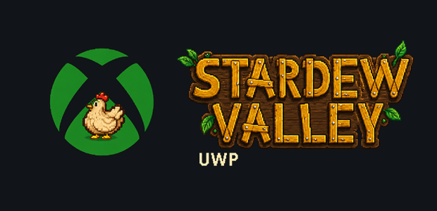

# StardewValleyUWP

<p align="center">
  
</p>


StardewValleyUWP runs the PC version of Stardew Valley on an Xbox in Developer Mode, with SMAPI for mods. The launcher downloads your copy of the game from Steam and installs mods from CurseForge, all with a controller.

It doesn't include any Stardew Valley files. You need to own the game on Steam.

> Only tested on a Series S. The Series X and Xbox One haven't been tried.

## Requirements

- An Xbox in Developer Mode, and a PC to reach its Device Portal.
- Stardew Valley on Steam. 1.6.15 is the version tested.
- A free CurseForge API key from [console.curseforge.com](https://console.curseforge.com), only needed for the mod browser.

## Getting started

1. In the Device Portal on your PC, install the package from the Releases page with `Microsoft.VCLibs.x64.14.00.appx` as its dependency.
2. Open **StardewValleyUWP** on the console.
3. Choose **Download game**, scan the code with the Steam mobile app and approve the sign in. Press **A** to start the download.
4. Choose **Play**.

You can skip the Steam download by copying a game folder into `LocalState\game` with the Device Portal file explorer. It has to contain `Stardew Valley.dll`.

Saves, mods and settings live in the app's `LocalState`, so installing a new package over the old one keeps them. Uninstalling the app deletes them, so **back up your saves first**.

## Status

| Area | Status |
| --- | --- |
| Base game, controller and sound | Tested on a Series S |
| Saves | Written to the console and load again |
| SMAPI 4.5.2 | Tested. Content Patcher, CJB Cheats Menu, Console Commands and Save Backup load |
| Content packs that edit images | Tested. Patches apply |
| CurseForge browsing and installing | Tested. An installed mod loads on the next launch |
| Game running from `LocalState\game` | Tested. The package holds no game files |
| Steam download from the launcher | Added, not yet tested on a console |
| CurseForge key entry from a phone | Added, not yet tested on a console |
| The launcher's current look | Added, not yet tested on a console |
| Suspend and resume | Not tested. Save before leaving the app |

## Launcher

| Button | Action |
| --- | --- |
| **A** | Select |
| **B** | Back, or cancel a download in progress |
| **LB** and **RB** | Change page in the mod browser |

The menu has **Play**, **Mods**, **Download game** and **Sign out of Steam**. Download game turns into **Update game** once the game is installed. Sign out forgets the Steam login.

The menu has a blurred farm picture behind it. Screenshots you take in game join it and take turns.

## Mods

SMAPI mods live in `LocalState\Mods`. Open **Mods** in the launcher to search CurseForge, browse the popular list, install a mod or delete one. A mod you install is loaded the next time you press Play.

CurseForge needs your own API key. Enter it from a phone on the same network, or upload a `curseforge.json` file to `LocalState` with the Device Portal:

```json
{"apiKey": "your key here"}
```

The key stays on the console and only goes to CurseForge. The phone page is plain http on your local network, so only use it on a network you trust.

Xbox Paths is a small mod that ships with the app. Without it the game can't list saves or load mod images, so the launcher warns you before deleting it.

## Where files live

All paths are inside the app's `LocalState` folder, which you can browse in the Device Portal.

| Path | Contents |
| --- | --- |
| `game` | The game files, with SMAPI beside them |
| `Mods` | SMAPI mods |
| `StardewValley\Saves` | Your saves |
| `StardewValley\ErrorLogs\SMAPI-latest.txt` | The SMAPI log |
| `stardew-host.log` | What the launcher and host did on the last start |
| `stardew-stdio.log` | The game's console output and any crash text |

If the game doesn't start, `stardew-host.log` is the first place to look.

## Known limitations

- Built for a controller. The Xbox doesn't give this app a mouse. A USB keyboard works.
- Tractor Mod and UI Info Suite 2 don't load. They need Stardew's custom sound cue and streamed Ogg classes, which this FNA build doesn't have yet.
- Mod dependencies aren't installed for you. Install Content Patcher and similar requirements yourself.
- Some CurseForge authors block downloads from other apps. Those mods can't be installed from the launcher.
- The mod browser doesn't check installed mods for updates.

## Building

Only needed if you want to build the package yourself. You don't need the game for it, the package is built from public sources and the game is downloaded on the console. It needs Windows with Visual Studio 2022 and its UWP workload, the Windows SDK, CMake 3.27 or newer and the .NET 8 SDK.

1. Clone tModLoader's [FNA](https://github.com/tModLoader/FNA) on `master`, [SDL](https://github.com/libsdl-org/SDL) on its `SDL2` branch, [FNA3D](https://github.com/FNA-XNA/FNA3D) on `master` and tModLoader's [FAudio](https://github.com/tModLoader/FAudio) on `win32`. Those branches hold the pinned commits.
2. Build FNA with Stardew's patches: `packaging\build-fna.ps1 -Source <FNA clone> -Work <fna folder>`. [`patches`](patches) explains what the patches do and which commits they apply to.
3. Build SDL2, FNA3D and FAudio for UWP: `packaging\build-native.ps1 -SdlSource <clone> -Fna3dSource <clone> -FAudioSource <clone> -BuildRoot <native folder>`.
4. Lay out the package: `packaging\stage-package.ps1 -MonoGameFramework <fna folder>\bin\Release\net6.0\MonoGame.Framework.dll -Work <work folder> -PackageOut <package folder>`. It downloads SMAPI 4.5.2 and the .NET 6 host files, checks them against pinned hashes and builds the Xbox Paths mod.
5. Configure CMake with `-DCMAKE_SYSTEM_NAME=WindowsStore -DCMAKE_SYSTEM_VERSION=10.0 -DSTARDEW_UWP_PACKAGE_STAGE=<package folder> -DSTARDEW_UWP_NATIVE_BUILD=<native folder>`, then build the `stardew_uwp_host` target.
6. The package comes out unsigned. Sign it with your own certificate before installing it.

The release workflow in `.github/workflows` runs these same steps on every push to main and puts the result up as the nightly release.

A normal desktop configure builds the two tools instead. `stardew_launcher_preview` renders every launcher screen to png, and `stardew_cf_probe` runs the CurseForge code without a console.

## About

This is an unofficial community project. It isn't affiliated with ConcernedApe, Valve, the SMAPI team or CurseForge. Stardew Valley is a trademark of ConcernedApe.

It runs on [FNA](https://fna-xna.github.io), SDL2, FNA3D and FAudio, with [SMAPI](https://smapi.io) included unmodified. The patches to FNA and FNA3D are in [`patches`](patches) and the bundled libraries are in [`third_party`](third_party).

Licensed under the [MIT license](LICENSE).
